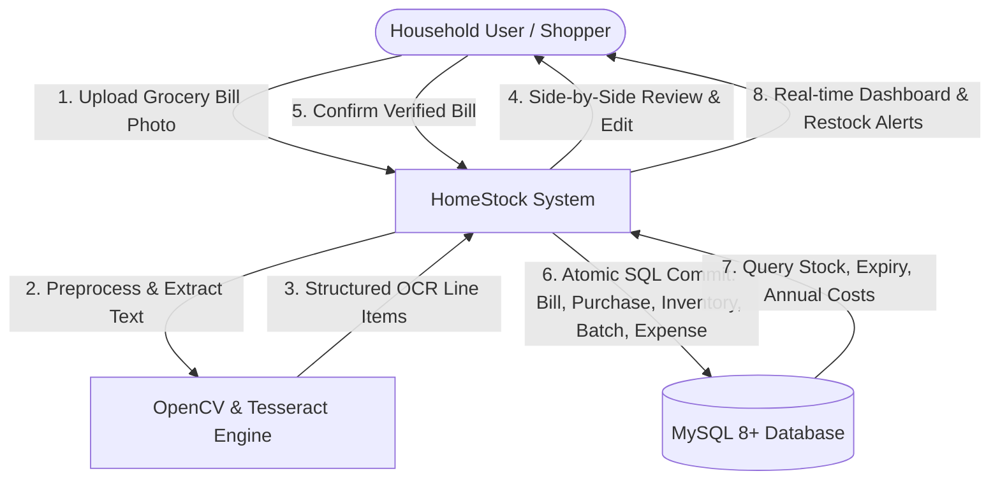
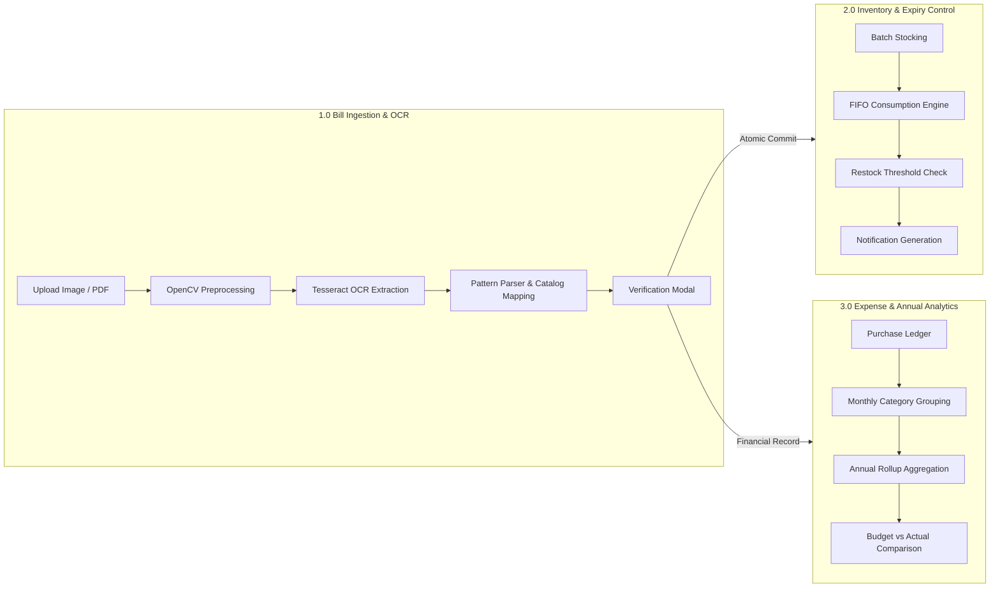

# HOMESTOCK: Data Flow & Use Case Architecture
**Intelligent Household Grocery, Inventory & Expense Management System**
*DBMS Academic Project Documentation*

---

## 1. Level 0 Data Flow Diagram (Context Diagram)

---

## 2. Level 1 Data Flow Diagram (Subsystem Decompositions)

---

## 3. Academic Use Case Descriptions

### Use Case UC-1: Smart Grocery Bill Digitization & Storage
- **Actor**: Household User
- **Precondition**: User is authenticated with JWT token.
- **Trigger**: User drops a receipt image (JPG/PNG/PDF) into the scanner dropzone.
- **Main Flow**:
  1. FastAPI validates MIME type and file size (< 10MB).
  2. Image is converted to grayscale, contrast-boosted via Pillow/OpenCV.
  3. Tesseract OCR reads the image and returns raw bill text.
  4. Parser extracts Store Name, Date, Items, Quantities, Unit Prices, Taxes, and Grand Total.
  5. Extracted data is presented in a split-screen view: original image on the left, editable data grid on the right.
  6. User inspects, edits any OCR discrepancies, and clicks "Confirm & Save".
  7. Backend initiates an ACID transaction:
     - Stores original image as binary BLOB in `bills`.
     - Inserts record into `purchases`.
     - Creates batch in `inventory_batches`.
     - Updates existing stock or inserts new product in `products`.
     - Logs audit line in `stock_movements`.
     - Creates expense entry in `expenses`.
- **Postcondition**: Stock levels are automatically incremented and expense charts reflect the new bill.

### Use Case UC-2: Intelligent Monthly List Generation
- **Actor**: Household User
- **Precondition**: User has defined recurring essentials (e.g. Milk 15L, Rice 10kg).
- **Trigger**: User requests new monthly shopping plan.
- **Main Flow**:
  1. System executes SQL query joining `recurring_grocery_items` with current `products.current_quantity`.
  2. For each recurring item, calculates `quantity_to_buy = max(1.0, preferred_qty - current_stock)`.
  3. Scans `products` for any items where `current_quantity <= min_stock_level` not present in recurring list.
  4. Generates an editable checklist with estimated costs.
- **Postcondition**: User has a customized shopping list ready for the market.
