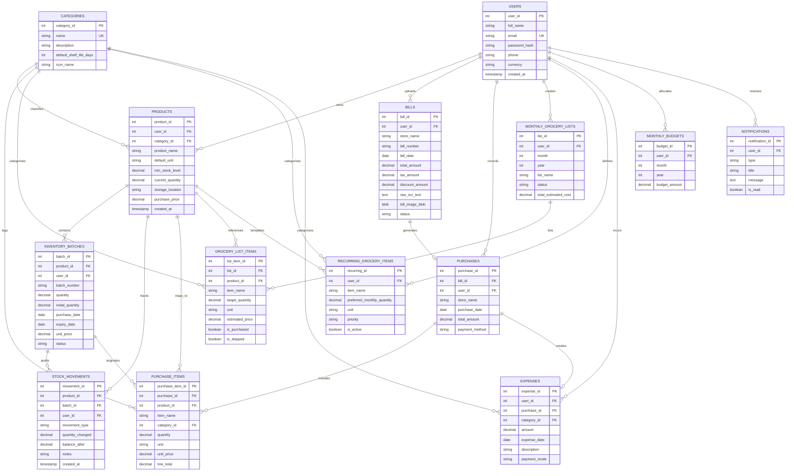

# HOMESTOCK: Entity-Relationship (ER) Architecture
**Intelligent Household Grocery, Inventory & Expense Management System**
*DBMS Academic Project Documentation*

---

## 1. Relational Entity-Relationship Diagram (Mermaid)

---

## 2. Relational Cardinality & Normalization

1. **Third Normal Form (3NF) Compliance**:
   - Every non-key column is fully functionally dependent on the Primary Key.
   - Transitive dependencies are removed (e.g. Category details reside in `categories`, not duplicated in `products` or `purchase_items`).
   - Line total calculations are strictly validated via SQL integrity checks.
2. **Referential Integrity**:
   - `ON DELETE CASCADE`: Deleting a user safely cascades to their inventory, bills, lists, and expenses.
   - `ON DELETE SET NULL`: Deleting a bill does not destroy historical financial accounting in purchases or stock audit trails.
3. **BLOB Storage**:
   - Original physical receipt photos are preserved directly inside the MySQL database in the `bill_image_blob` column (`LONGBLOB`).
